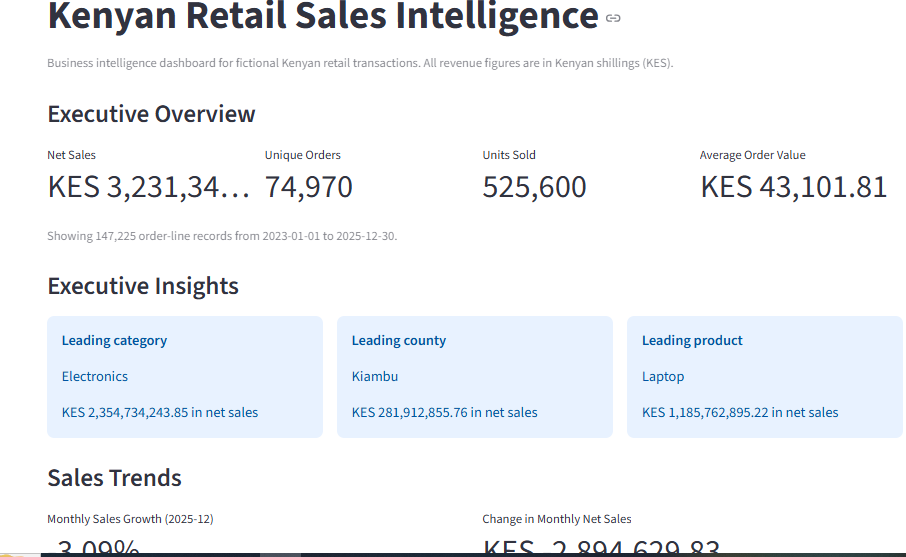
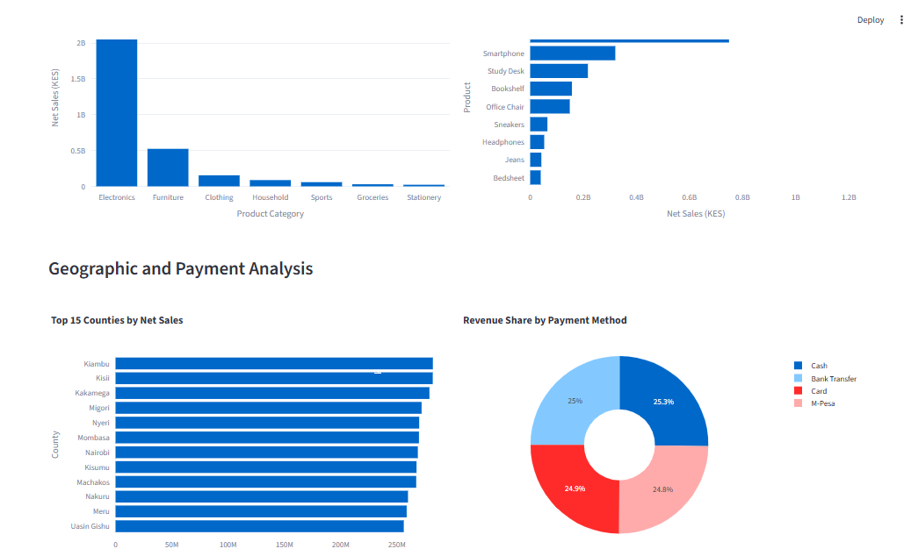

# Kenyan Retail Data Quality & Analytics Dashboard

**Live Dashboard:** https://pandas-data-cleaning-analytics-8hevup595lobny3fxqb3vk.streamlit.app/

**GitHub Repository:** https://github.com/vincentokello770-arch/pandas-data-cleaning-analytics

**Author:** Vincent Kenyatta  
**Project type:** Data Cleaning, Exploratory Data Analysis & Business Intelligence  
**Technologies:** Python, Pandas, NumPy, Matplotlib, Streamlit, Plotly, pytest, Git and GitHub

## Project Overview

This project demonstrates an end-to-end data analytics workflow that transforms messy retail transaction data into validated, analysis-ready information and an interactive business intelligence dashboard.

The project uses an entirely synthetic dataset representing a fictional Kenyan retailer. It includes realistic data-quality challenges such as missing customer identifiers, inconsistent text labels, mixed date formats, duplicate records, and invalid quantities or prices.

The solution combines a reproducible Python data-cleaning pipeline with analytical reports, data-quality validation, automated tests, and a Streamlit dashboard for interactive sales analysis.

## Business Problem

Retail businesses depend on accurate transaction data to monitor revenue, understand customer purchasing patterns, evaluate product performance, and make informed operational decisions.

Poor-quality data can lead to misleading KPIs, incorrect sales comparisons, and unreliable business reports.

This project addresses these challenges by:

- Generating reproducible synthetic retail transaction data.
- Profiling missing values and other data-quality issues.
- Standardizing inconsistent fields and date formats.
- Identifying and removing exact duplicate records.
- Separating rejected records and documenting rejection reasons.
- Calculating net sales and aggregating business KPIs.
- Validating cleaned data using automated checks and tests.
- Presenting the results through an interactive business intelligence dashboard.

## Project Objectives

1. Build a reproducible data-generation and cleaning pipeline.
2. Improve data quality while preserving valid transactions.
3. Measure data retention and document rejected records.
4. Produce reliable sales KPIs and analytical reports.
5. Develop an interactive dashboard for business users.
6. Demonstrate Python programming, data analysis, testing, version control, and technical documentation.
7. Establish a foundation for future Power BI, SQL database, and cloud analytics projects.

## Technology Stack

| Technology | Purpose |
|---|---|
| Python 3.10 | Pipeline execution and application logic |
| Pandas | Data cleaning, transformation, grouping, and analysis |
| NumPy | Numerical operations |
| Matplotlib | Static analytical charts |
| Streamlit | Interactive dashboard application |
| Plotly | Interactive charts and visualizations |
| pytest | Automated testing |
| Git | Version control |
| GitHub | Source code hosting and portfolio presentation |
| Windows PowerShell | Command-line workflow |

## Project Architecture

The project follows a staged data-processing workflow:

```text
Synthetic Raw Sales Data
          |
          v
    Data Profiling
          |
          v
    Data Cleaning
          |
          +--------------------+
          |                    |
          v                    v
   Cleaned Dataset      Rejected Records
          |
          v
   Data Validation
          |
          v
   Sales Analytics
          |
          +--------------------------+
          |                          |
          v                          v
    CSV Reports              Static Charts
          |
          v
  Streamlit Dashboard
          |
          v
 Interactive Business Insights
```

## Project Structure

```text
pandas-data-cleaning-analytics/
├── dashboard/
│   └── app.py
├── data/
│   ├── raw/
│   └── processed/
├── reports/
│   ├── charts/
│   ├── data_quality_report.csv
│   ├── monthly_sales.csv
│   ├── sales_by_category.csv
│   ├── sales_by_county.csv
│   ├── sales_by_payment_method.csv
│   ├── sales_kpis.csv
│   └── top_10_products.csv
├── src/
│   ├── generate_data.py
│   ├── profile_data.py
│   ├── clean_data.py
│   └── analyze_data.py
├── tests/
│   ├── test_cleaning.py
│   └── __init__.py
├── validate_clean_data.py
├── requirements.txt
├── pytest.ini
├── .gitignore
└── README.md
```

Generated datasets and other local artifacts are excluded from Git where appropriate. Some output files are created when the pipeline runs.

## Data Quality Results

The latest verified synthetic dataset produced the following results:

| Metric | Result |
|---|---:|
| Raw records | 150,060 |
| Exact duplicate records removed | 60 |
| Records after deduplication | 150,000 |
| Rejected records | 2,775 |
| Clean records retained | 147,225 |
| Clean-record retention rate | 98.15% |
| Unique orders | 74,970 |
| Total units sold | 525,600 |
| Total net sales | KES 3,231,342,563.01 |
| Average order value | KES 43,101.81 |
| Data-validation checks passed | 24 of 24 |
| Automated tests passed | 2 |

These figures describe the generated synthetic dataset. They are not actual financial results from a Kenyan retailer.

### Data Quality Approach

The pipeline demonstrates:

- Missing-value profiling.
- Date parsing and normalization.
- Standardization of inconsistent fields.
- Duplicate detection and removal.
- Validation of quantities, prices, and other defined business rules.
- Separation of rejected records for review.
- Reproducible generation and cleaning.
- Validation of the cleaned dataset before downstream analysis.

The retention rate is the proportion of the original raw records retained in the final clean dataset. The pipeline's deduplication and rejection counts are documented separately to make the transformation process auditable.

## Interactive Dashboard

The project includes a Streamlit dashboard titled **Kenyan Retail Sales Intelligence**.

### Executive Overview

The dashboard provides four headline KPIs:

- **Net Sales:** total recorded net sales in Kenyan shillings.
- **Unique Orders:** distinct order IDs in the filtered data.
- **Units Sold:** total recorded units sold.
- **Average Order Value:** net sales divided by the number of distinct orders.

### Executive Insights

The dashboard automatically identifies:

- The leading product category by net sales.
- The leading county by net sales.
- The leading product by net sales.

These insights respond to the selected dashboard filters.

### Sales Trends

The dashboard includes:

- Monthly net sales trends.
- Unique orders by month.
- Month-over-month percentage sales growth.
- Absolute changes in monthly net sales.

Growth compares the latest month in the filtered data with the preceding calendar month. Percentage growth is unavailable when the previous month's sales are zero or when insufficient monthly data exists.

### Product Performance

Users can explore:

- Net sales by product category.
- The top 10 products by net sales.
- Units sold for products in the top-product chart.

### Geographic and Payment Analysis

The dashboard presents:

- The top 15 counties by net sales.
- Revenue share by payment method.

### Interactive Filters and Exports

Users can filter the dashboard by:

- Order date range.
- County.
- Product category.
- Payment method.
- Sales channel.

The transaction details table responds to these filters and allows users to download the filtered records as a CSV file.

All dashboard metrics and visualizations are based on the current filter selections.

## Environment Setup

These instructions assume Windows with Python 3.10 available through the Python launcher.

Open PowerShell and navigate to the project root:

```powershell
cd "C:\Users\vincey graphics\pandas-data-cleaning-analytics\pandas-data-cleaning-analytics"
```

For a fresh checkout, create a virtual environment:

```powershell
py -3.10 -m venv .venv
```

Install the dependencies:

```powershell
& ".\.venv\Scripts\python.exe" -m pip install -r requirements.txt
```

If PowerShell blocks virtual-environment activation, you can use the explicit Python path shown in these instructions without activating the environment.

## Run the Data Pipeline

Run each stage from the project root, in order:

```powershell
& ".\.venv\Scripts\python.exe" .\src\generate_data.py
& ".\.venv\Scripts\python.exe" .\src\profile_data.py
& ".\.venv\Scripts\python.exe" .\src\clean_data.py
& ".\.venv\Scripts\python.exe" .\validate_clean_data.py
& ".\.venv\Scripts\python.exe" .\src\analyze_data.py
& ".\.venv\Scripts\python.exe" -m pytest -q
```

Run the generator first because the later stages depend on its output. The generator uses a fixed random seed to support reproducibility.

Running the pipeline regenerates local data and reports. Use the generated outputs from the same pipeline run when comparing results.

## Launch the Dashboard

The dashboard requires the cleaned dataset to exist at:

```text
data/processed/clean_sales.csv
```

After running the pipeline, launch the application:

```powershell
& ".\.venv\Scripts\python.exe" -m streamlit run .\dashboard\app.py
```

Streamlit normally opens the dashboard in your browser at:

```text
http://localhost:8501
```

Keep the terminal running while using the dashboard. Press `Ctrl+C` in that terminal to stop the server.

## Testing and Validation

The project includes automated tests and a separate cleaned-data validation script.

Run the automated tests:

```powershell
& ".\.venv\Scripts\python.exe" -m pytest -q
```

The latest recorded test result was:

```text
2 passed
```

Run the data-quality validator:

```powershell
& ".\.venv\Scripts\python.exe" .\validate_clean_data.py
```

The latest recorded validation result was 24 of 24 checks passed.

Check the dashboard's Python syntax:

```powershell
& ".\.venv\Scripts\python.exe" -m py_compile .\dashboard\app.py
```

The syntax check should finish without output when no syntax errors are found.

## Generated Outputs

The pipeline produces analytical and quality-assurance artifacts, including:

- Cleaned transaction data.
- Rejected records and rejection reasons.
- A data-quality report.
- Monthly sales summaries.
- Sales KPIs.
- Sales by product category.
- Sales by county.
- Sales by payment method.
- Top-product reports.
- Order-level analysis.
- Static charts for sales trends and category, payment, and county performance.

The dashboard adds interactive charts, filtered transaction details, executive insights, and CSV export.
## Dashboard Screenshots

### Executive Overview



### Analytics and Trends



## Data Governance and Limitations

- All transaction data is synthetic; no real customer or student records are used.
- Missing customer IDs are retained when the defined cleaning rules permit them.
- Rejected records are separated for review instead of being silently discarded.
- Net sales and average order value depend on the cleaning, calculation, and aggregation rules implemented in the pipeline.
- Order counts use distinct order IDs, avoiding the assumption that every order line represents a separate order.
- Data-validation checks test defined conditions but cannot guarantee that every possible business issue has been detected.
- The dashboard is publicly deployed on Streamlit Community Cloud and uses a 5,000-row synthetic demo dataset.
- The full 147,225-row cleaned dataset remains local and is excluded from Git; the app automatically uses it when available locally and falls back to the demo dataset in the cloud.
- Generated data must be recreated before running the dashboard in a fresh environment.

## Future Improvements

Planned enhancements include:

- Expand the automated test suite with additional edge cases and regression tests.
- Add documented database schemas and ER diagrams.
- Load cleaned data into SQLite and PostgreSQL.
- Build a complementary Power BI dashboard.
- Add GitHub Actions for automated testing.
- Add documented analytical assumptions and business recommendations.
- Compare alternative cleaning rules and measure their effects on reported KPIs.

## Skills Demonstrated

This project demonstrates practical experience with:

- Python data processing.
- Data profiling and data-quality assessment.
- Missing-value handling and date normalization.
- Duplicate detection and rejection auditing.
- Data validation and reproducible pipelines.
- Aggregation, KPI calculation, and exploratory data analysis.
- Interactive business intelligence dashboards.
- Plotly visualizations and Streamlit applications.
- Automated testing with pytest.
- Git version control and GitHub collaboration workflows.
- Technical documentation and reproducible project setup.

## Author

**Vincent Kenyatta**  
ICT Professional | Data Analytics | Python | Cloud Engineering

GitHub: [vincentokello770-arch](https://github.com/vincentokello770-arch)

Project repository: [Pandas Data Cleaning & Analytics](https://github.com/vincentokello770-arch/pandas-data-cleaning-analytics)

---

*This portfolio project demonstrates practical data engineering and analytics methods using fictional data. Reported metrics reflect the latest documented local pipeline run.*